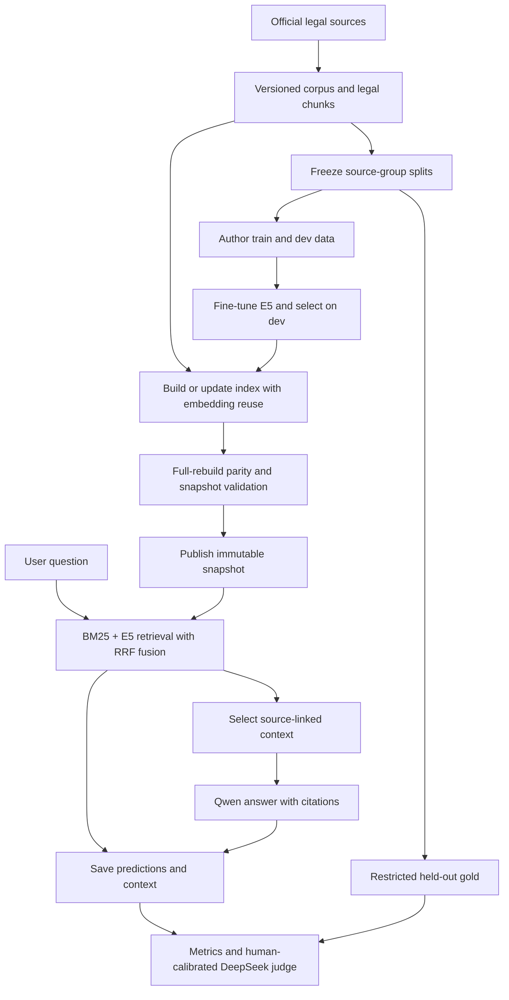

# VietLegal SearchOps

A research project for Vietnamese labour-contract search and question answering. The design combines BM25 and multilingual E5 retrieval, Qwen answers with source citations, and incremental index updates with exact-input embedding reuse.

**Status:** architecture scaffold. Python modules, configuration, prompts, tests, and deployment files currently describe planned behavior. The application is not runnable yet, and no experiment results are included.

## Planned workflow

Each request uses one pinned snapshot so retrieval, answers, and citations refer to the same source revisions. Retrieval-only runs need no LLM. Held-out gold enters scoring after predictions are saved; answer evaluation replays the exact context sent to Qwen.

## Repository guide

| Path | Purpose |
| --- | --- |
| `src/vietlegal_searchops/` | Planned ingestion, corpus, datasets, training, indexing, retrieval, answering, and evaluation modules |
| `config/`, `prompts/`, `rubrics/` | Configuration, prompt, and judging specifications |
| `tests/` | Planned offline checks and fixture requirements |
| `deploy/`, `web/` | Deployment and demo placeholders |
| `artifacts/` | Artifact layout and access rules; generated data is excluded from Git |
| `.agents/skills/` | Shared English workflows for development, handoffs, debugging, review, and focused Git commits |

See [ARCHITECTURE.md](ARCHITECTURE.md) for module contracts and implementation order. The detailed workflow is available as [SVG](workflow.svg), [editable HTML](workflow.html), and [design notes](workflow_notes.md). Runtime requirements and setup commands will be added when implementation begins.

## Shared AI workflow

Both contributors should start from [AGENTS.md](AGENTS.md) and the
[skill catalog](.agents/skills/README.md). The skills use the same local project
contracts and fixtures; they require appropriate verification of implementation
work and distinguish offline checks from live model runs. When asked to commit,
agents split independent changes into coherent commits with clear English
messages. The Git skill includes optional Lazygit staging guidance.

Local planning material in `docs/` is ignored by Git. The architecture and shared
skill references contain the contracts needed to use this checkout independently.
